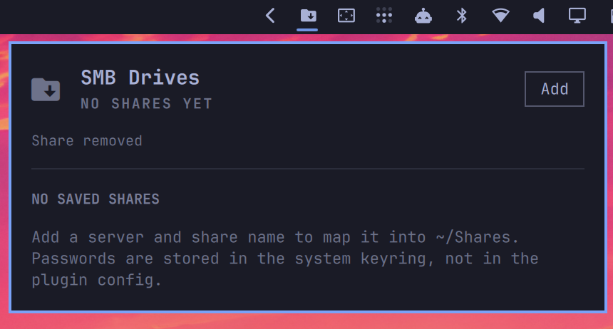
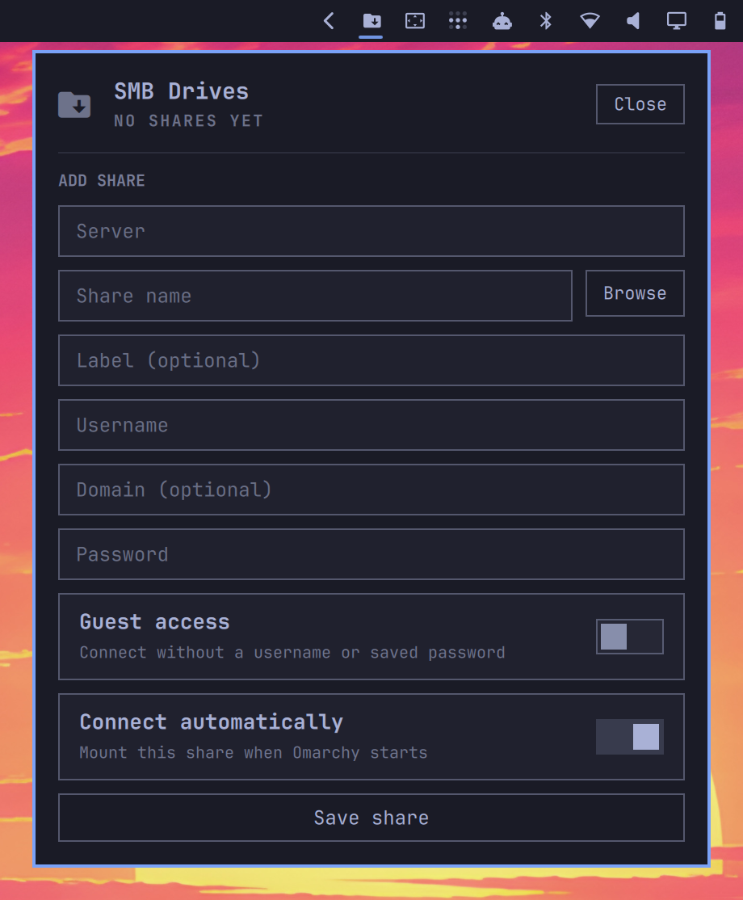

# SMB Drive Mapper

Map SMB/CIFS network shares from the Omarchy bar without putting passwords in
config files or on the command line.

<p align="center">
  
</p>

The plugin saves share metadata locally, stores credentials in the system
keyring through `secret-tool` / libsecret, and mounts with GVFS (`gio`) so
**no root or polkit prompt is required**. Connected shares also appear as
shortcuts under `~/Shares`.

**This plugin does not write `/etc/fstab`.** Connect automatically remounts the
share in your user session when Omarchy starts. It never adds a kernel CIFS
entry, never stores a credentials file for fstab, and never asks for sudo.

<p align="center">
  
</p>

## Requirements

These packages ship with a normal Omarchy install:

- Omarchy 4 (Quattro) and its Quickshell plugin host
- `gvfs`, `gvfs-smb`, `libsecret`, `python-gobject`, `smbclient`
- An unlocked user keyring (`gnome-keyring`)

The plugin never runs `sudo` or `pkexec`. It does not install packages, write
sudoers rules, or change `/etc/fstab`.

## Install

```bash
omarchy plugin add https://github.com/Bmontythe3rd/omarchy-smb-mapper.git --enable
```

It is placed in the bar's right section by default, next to Network.

For local development from a checkout:

```bash
omarchy plugin add /absolute/path/to/omarchy-smb-mapper --enable
omarchy restart shell
```

## Use

1. Click the network-folder icon in the bar.
2. Choose **Add**, enter the server and share name, then your username.
3. Optionally click **Browse** to list folders advertised by the server.
4. Save. The password is written only to the system keyring.
5. Click a saved share to connect or disconnect it.
6. Enable **Connect automatically** if it should mount after login.

The open-folder action launches Files (Nautilus) on the `smb://` URI. Mounted
shares are also linked from `~/Shares/<label>`. Press `n` to add a share, `o`
to open the selected folder, `r` to refresh, and Escape to close the panel.

## Update

```bash
omarchy plugin update io.github.bmontythe3rd.smb-mapper
```

## Remove

```bash
omarchy plugin remove io.github.bmontythe3rd.smb-mapper --yes
```

Optionally remove saved share names (this does not delete keyring secrets):

```bash
rm -r "${XDG_CONFIG_HOME:-$HOME/.config}/omarchy-smb-mapper"
rm -r "$HOME/Shares"
```

Forget stored passwords from Seahorse / the Secret Service, or with:

```bash
secret-tool clear application omarchy-smb-mapper
```

## Security

- Passwords never land in `shares.json`, plugin settings, git, or process argv.
- The helper reads a password only from stdin or libsecret, then forgets it.
- Config lives in `~/.config/omarchy-smb-mapper/` with directory mode `0700`
  and file mode `0600`.
- Temporary SMB credential files used to browse a server are created under
  `$XDG_RUNTIME_DIR` and deleted immediately.
- Mounts are user-session GVFS mounts, not kernel CIFS mounts and not fstab
  entries.
- Host, share, username, and label values are validated before use.

See [SECURITY.md](SECURITY.md) for the full credential model.

As with all community plugins, inspect the source before installation. Omarchy
plugins run as the current user and are not sandboxed.

## Development

```bash
tests/run.sh
```

The helper tests use a fake mount backend (`OMARCHY_SMB_TEST=1`) and never
touch a real SMB server or the login keyring.

## License

[MIT](LICENSE)
